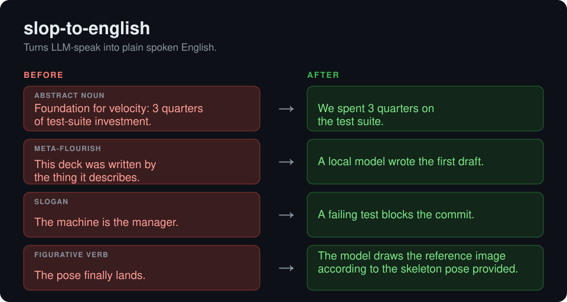

# slop-to-english



Rewrites LLM-speak as plain spoken English. Clone it into your skills folder, then run `/slop-to-english`.

```
git clone https://github.com/andrsnn/slop-to-english ~/.claude/skills/slop-to-english
python evals/run_eval.py --openai-url http://127.0.0.1:8080/v1 --model qwen --skill
```

To rewrite many strings at once (UI copy, item descriptions), put them in a JSON list and run
`rewrite_batch.py`. It sends them in batches with SKILL.md as the system prompt, at most 3 requests at a time,
and checks each rewrite: same placeholders and tags, not longer, no new numbers or names.

```
python rewrite_batch.py strings.json out.json --openai-url http://localhost:11434/v1 --model glm-5.3:cloud
python -m unittest evals/test_rewrite_batch.py
```

[Examples](EXAMPLES.md) · [Research](docs/research.md) · [Test cases](evals/cases.jsonl) · Other LLMs: paste [SKILL.md](SKILL.md) as the prompt
